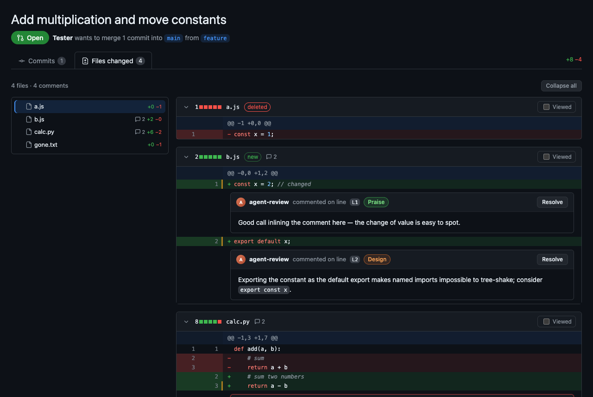
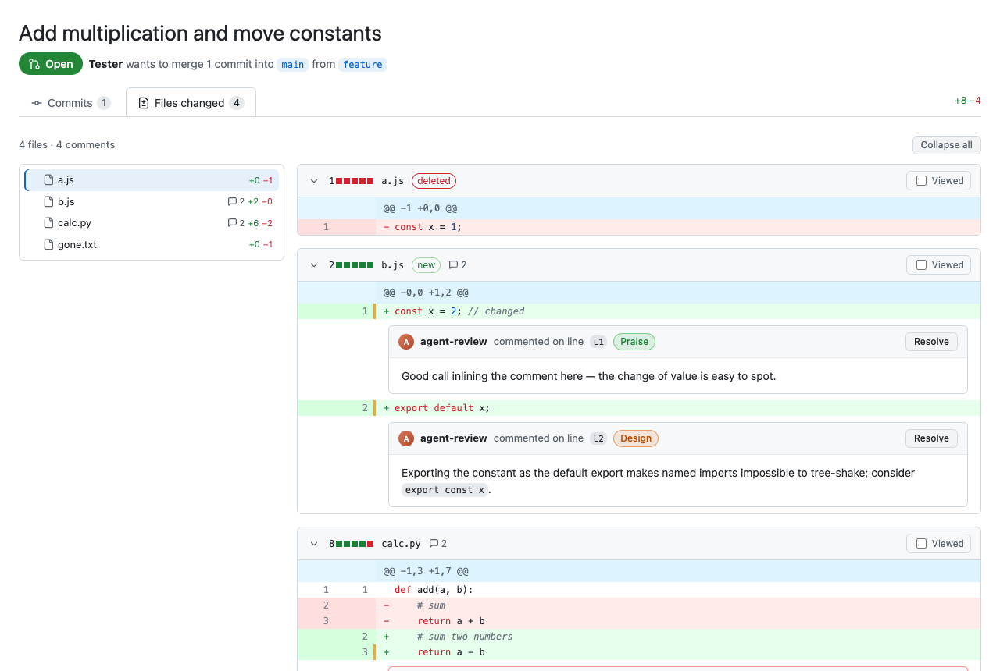

# pr-review-html

An [agent skill](https://agentskills.io) that reviews the changes on a git branch and delivers the
review as a self-contained, GitHub pull-request-style HTML page, with the findings as inline
comments on the diff.

It works with any agent that supports `SKILL.md` skills: Claude Code, Codex, OpenCode, Gemini CLI,
pi, Factory and others.



## What you get

- **A real review**: the agent reads the surrounding code, not just the diff, and focuses on
  design and correctness rather than style nitpicks. Each finding is tagged Blocking, Suggestion,
  Question, Design, Praise or Nit.
- **A PR-style page**: inline comment threads on the exact lines, a collapsible file tree that
  smooth-scrolls to files, Resolve toggles, Viewed checkboxes, and a Commits tab.
- **Readable code**: syntax highlighting for common languages, and long lines scroll inside the
  card instead of wrapping.
- **Light and dark mode**, following your system theme, and a layout that works down to phone
  width.
- **One file, no dependencies**: the page is a single HTML file, and the renderer only needs
  Python 3.9+ and git.



## Install

With the [skills CLI](https://github.com/vercel-labs/skills):

```bash
npx skills add Quinus/pr-review-html
```

Or manually: copy `skills/pr-review-html` into your agent's skills folder, for example
`~/.claude/skills/`, `~/.codex/skills/` or `~/.config/opencode/skills/`. If you use several
agents, keep one copy in `~/.agents/skills/` and symlink it into each agent's folder.

## Use

Ask your agent something like:

- "Review this branch against main and make it an HTML page"
- "Review `feature/login` and show it like a GitHub PR"
- "Turn your review into a page with inline comments"

The agent writes a small review file (JSON) and renders it with the bundled script. The page is
saved outside your source tree, in the location your project instructions name for generated
files, or otherwise in `/tmp/pr-reviews/<repo>/`.

### Running the renderer yourself

```bash
python3 skills/pr-review-html/scripts/render_review.py \
  --repo . --base main --head my-branch \
  --review review.json --out review.html
```

See [`references/review-format.md`](skills/pr-review-html/references/review-format.md) for the
review file format, and [`examples/`](examples) for a sample review and its rendered page.

## License

MIT
